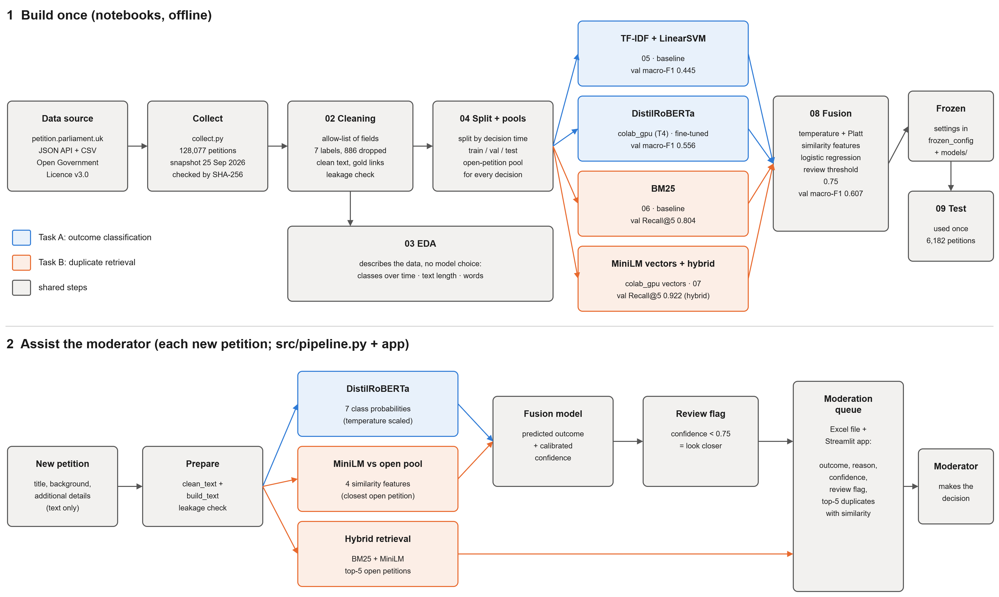

# Petition Moderation Assistant

Rejection-reason classification and duplicate retrieval for UK Parliament e-petitions (2015–2026).

CS5998 Capstone Project – Master of Data Science & Artificial Intelligence, University of Moratuwa
N.V.Y. Priyashan (268481U)

## Problem

About two in every three petitions submitted to the UK Parliament petitions website are rejected, and roughly half of those are duplicates of a petition that is already open. Moderators check every petition by hand. This project uses the petition text to (1) predict the outcome and rejection reason, and (2) find the open petitions a new petition duplicates. The moderator keeps the final decision. No external LLM API is used.

## Architecture



Top: how the system is built once, notebook by notebook. Bottom: what happens to each new petition. Blue steps
belong to task A (outcome classification), orange steps to task B (duplicate retrieval). The editable source is
`reports/figures/architecture.drawio` (open it in draw.io).

## Results

Measured once on the test split: petitions decided January–August 2026, which no model or setting saw before
(all settings were chosen on validation and frozen first). Details in `notebooks/09_final_evaluation.ipynb` and
`notebooks/10_error_analysis.ipynb`.

**Task A: predict the outcome (7 classes, 6,182 test petitions)**

| Model | Macro-F1 [95% CI] | Accuracy |
|---|---|---|
| TF-IDF + linear SVM (baseline) | 0.415 [0.391–0.435] | 63.7% |
| Fine-tuned DistilRoBERTa | 0.521 [0.497–0.544] | 68.0% |
| DistilRoBERTa + similarity features, calibrated fusion (**final**) | **0.583** [0.558–0.606] | **76.0%** |

**Task B: find the duplicated open petition (1,728 test duplicates)**

| Method | Recall@1 | Recall@5 | MRR |
|---|---|---|---|
| BM25 (baseline) | 0.544 | 0.864 | 0.682 |
| MiniLM sentence vectors | 0.670 | 0.927 | 0.785 |
| Hybrid BM25 + MiniLM (**final**) | 0.685 | **0.941** | 0.798 |

- **Honest confidence:** the expected calibration error falls from 0.137 to 0.014. With a review threshold of 0.75,
  61% of petitions are not flagged and 89% of those are correct, while 72% of all errors are flagged for review.
- **The two tasks support each other:** for 96.8% of the duplicates the classifier misses, the correct open petition
  is still in the top-5 list the moderator sees.
- **Each improvement is significant** (McNemar test, p < 0.001); the confidence intervals come from 1,000 bootstrap samples.
- **Where it fails:** most remaining errors need knowledge that is not in the petition text, such as who is
  responsible for an issue or what the Government is already doing.

## Data

- Source: https://petition.parliament.uk (JSON API and CSV exports)
- Licence: Open Government Licence v3.0
- Coverage: 2015–17, 2017–19, 2019–24 and the current Parliament (128,077 petitions, snapshot 25 Sep 2026)
- The data is not stored in git. Run `src/collect.py` to download it. The results use the snapshot of 25 Sep 2026.
  The site keeps changing, so a new download will differ slightly; `02_cleaning` checks the snapshot's SHA-256 hash.

## How to run

Python 3.12 (tested with 3.12.10 on Windows 11). Create a virtual environment in the repo folder and install the
pinned packages:

```
python -m venv .venv
.venv\Scripts\python.exe -m pip install -r requirements.txt
```

On macOS or Linux, use `.venv/bin/python` instead of `.venv\Scripts\python.exe`.

Data collection (Milestone 1):

```
.venv\Scripts\python.exe src\collect.py      # about 1 hour, writes data/petitions.jsonl
.venv\Scripts\python.exe src\check_data.py   # prints petition counts and rejection reasons
```

Then run the notebooks in order, with the `.venv` Python as the kernel (in VS Code: Select Kernel → `.venv`):

| Notebook | What it does |
|---|---|
| `notebooks/02_cleaning.ipynb` | 7-class labels, gold duplicate pairs, text cleaning, leakage test |
| `notebooks/03_eda.ipynb` | exploratory analysis: classes over time, text length, distinctive words, moderation lag, duplicate similarity, data quality |
| `notebooks/04_split.ipynb` | train / validation / test split by decision time, time-aware candidate pools |
| `notebooks/colab_gpu.ipynb` | Google Colab, T4 GPU: sentence vectors (MiniLM, mpnet) and DistilRoBERTa fine-tuning |
| `notebooks/05_baseline_classifier.ipynb` | Google Colab, CPU runtime (needs about 4 GB of RAM): TF-IDF + LinearSVC baseline with Platt calibration |
| `notebooks/06_baseline_retrieval.ipynb` | BM25 duplicate retrieval over the time-aware pools, Recall@k and MRR on validation |
| `notebooks/07_embedding_retrieval.ipynb` | duplicate retrieval with MiniLM / mpnet sentence vectors and a BM25 + MiniLM hybrid, compared with BM25 |
| `notebooks/08_fusion.ipynb` | calibration, similarity features, fusion model, 2×2 comparison, review threshold, frozen configuration |
| `notebooks/colab_test_logits.ipynb` | Google Colab: the fine-tuned DistilRoBERTa scores the test and out-of-scope petitions (labels are not read) |
| `notebooks/09_final_evaluation.ipynb` | the one evaluation on the test split: 2×2 comparison with confidence intervals, McNemar tests, calibration, review flag, retrieval on both pools, out-of-scope test |
| `notebooks/10_error_analysis.ipynb` | where and why the final model is wrong on test: confusions, review flag, duplicates rescued by retrieval, 105 errors read and categorised |

The three Colab notebooks (`colab_gpu`, `05_baseline_classifier`, `colab_test_logits`) read the files of
`data/processed/` from a Google Drive folder (`DRIVE_DIR` in their first cell), take `src/` from this repository and
write their outputs back to Drive.

## Status

- [x] Project definition and data collection (Milestone 1)
- [x] Preprocessing, EDA, baseline and improved models, evaluated on validation
- [x] Final evaluation on the test split and error analysis
- [ ] Moderation pipeline (Excel queue) and Streamlit app (in progress)
- [ ] Final report